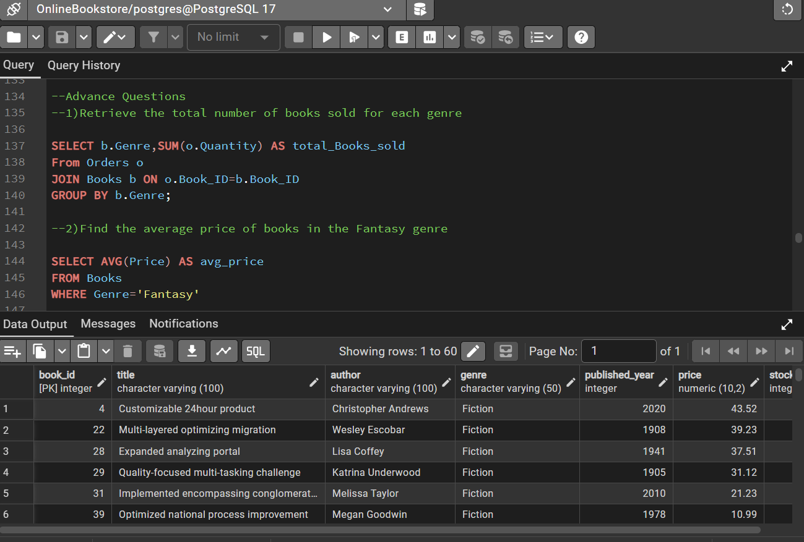
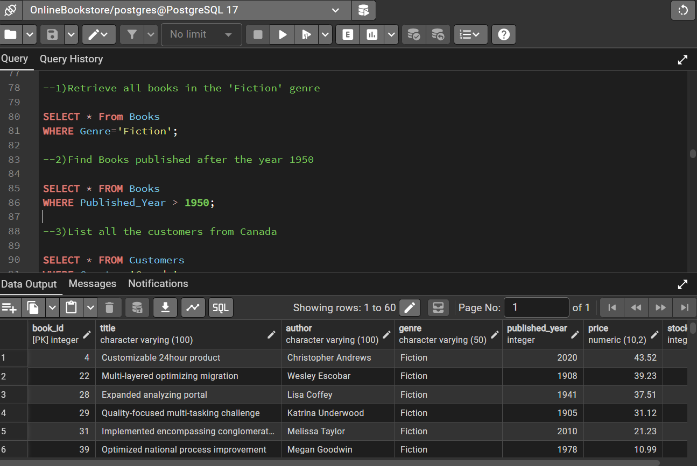

# 📚 Online Book Store (PostgreSQL)

**A database-driven project that manages books, customers and orders, with advanced SQL queries for real-world reporting.**

## Overview

The Online Book Store is built entirely on PostgreSQL. It stores book details, customer information and orders, and uses analytical SQL to answer business questions about sales, customers and inventory.

## Screenshots

## Features

- Store and manage book details: title, author, genre, price and stock
- Track customer information and purchase history
- Handle orders with multiple books and quantities
- Generate analytical reports with advanced SQL

## SQL Concepts Used

| Concept | Used for |
|---|---|
| `GROUP BY` and aggregate functions | Sales totals per genre, author or customer |
| `HAVING` | Filtering aggregated results |
| `COALESCE` | Handling NULL values in reports |
| `ORDER BY` | Ranking top books and customers |
| Joins | Combining books, customers and orders |

## Dataset

| File | Contents |
|---|---|
| `Books.csv` | Book catalog |
| `Customers.csv` | Customer details |
| `Orders.csv` | Orders and quantities |
| `OnlineBookstore.sql` | Table creation and analysis queries |

## Tech Stack

- **Database:** PostgreSQL
- **Language:** SQL (advanced queries)
- **Tools:** pgAdmin / psql

## How to Run

1. Create a new PostgreSQL database.
2. Run `OnlineBookstore.sql` in pgAdmin or psql to create the tables and queries.
3. Import `Books.csv`, `Customers.csv` and `Orders.csv` into the matching tables.
4. Run the analysis queries and compare with the screenshots above.

---

👩‍💻 Built by [Harshali](https://github.com/harshali8112) · 📫 info.harshali268@gmail.com
